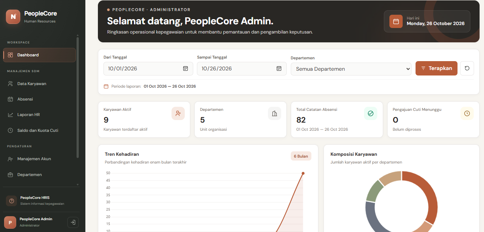
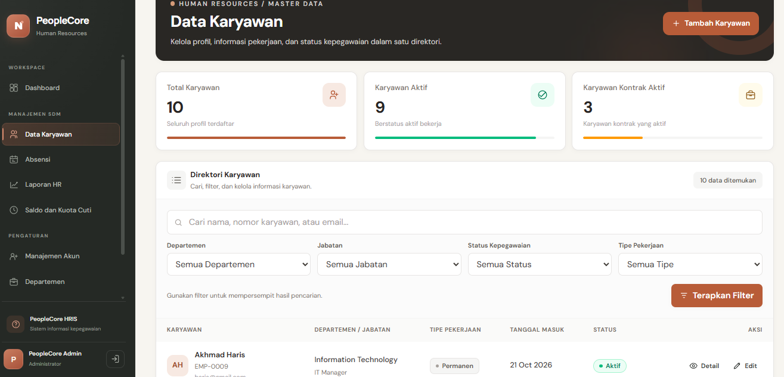
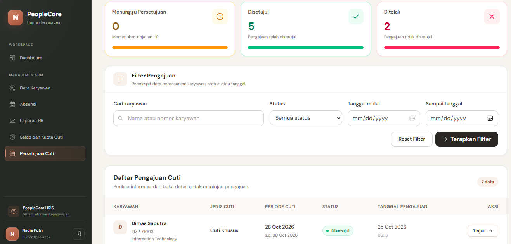

# PeopleCore — Human Resource Information System (HRIS)

PeopleCore adalah aplikasi berbasis web untuk membantu perusahaan mengelola informasi dan administrasi sumber daya manusia secara terstruktur. Aplikasi ini dikembangkan sebagai proyek portofolio untuk menerapkan kemampuan pengembangan sistem, pengelolaan basis data relasional, validasi data, pengaturan hak akses, serta penyajian informasi untuk mendukung aktivitas operasional HR.

Sistem ini mengintegrasikan pengelolaan data karyawan, struktur organisasi, riwayat kepegawaian, kehadiran, pengajuan cuti, kuota cuti, dan laporan HR dalam satu aplikasi.

## Preview Aplikasi

### Dashboard

Dashboard menyajikan ringkasan informasi kepegawaian sehingga pengguna dapat melihat gambaran umum data dan aktivitas HR melalui satu halaman.



### Manajemen Data Karyawan

Modul karyawan digunakan untuk mengelola informasi kepegawaian secara terstruktur. Fitur ini mendukung proses pengelolaan data sehingga informasi karyawan dapat dipelihara dan diakses sesuai kebutuhan serta hak akses pengguna.



### Persetujuan Cuti

Modul cuti mendukung alur administrasi permohonan cuti, mulai dari pengajuan hingga proses pemeriksaan dan persetujuan oleh pengguna yang memiliki kewenangan.



## Fitur Utama

### 1. Pengelolaan Data Karyawan

- Menambahkan, melihat, memperbarui, dan mengelola data karyawan.
- Mengelola informasi departemen dan jabatan.
- Menyediakan detail karyawan dan pencatatan riwayat kepegawaian.
- Menjaga keterkaitan data karyawan dengan data organisasi melalui basis data relasional.

### 2. Manajemen Kehadiran

- Mencatat informasi kehadiran karyawan berdasarkan tanggal.
- Mengelola status kehadiran serta waktu masuk dan keluar sesuai data yang dicatat.
- Menyediakan tampilan daftar kehadiran dan penyaringan data untuk mempermudah peninjauan.

### 3. Manajemen Cuti

- Mendukung pengajuan cuti oleh karyawan.
- Mendukung pemeriksaan dan persetujuan permohonan berdasarkan hak akses pengguna.
- Mengelola informasi kuota atau saldo cuti.
- Menyimpan informasi permohonan dan statusnya untuk membantu penelusuran administrasi cuti.

### 4. Laporan HR dan Ekspor Data

- Menyediakan laporan berdasarkan data HR yang tersedia dalam sistem.
- Mendukung peninjauan data untuk kebutuhan administrasi dan pemantauan.
- Menyediakan ekspor laporan ke format CSV agar data dapat digunakan lebih lanjut dalam spreadsheet atau proses pengolahan data lainnya.

### 5. Akun dan Hak Akses

Sistem menerapkan pembagian akses berdasarkan peran pengguna untuk membatasi penggunaan fitur sesuai kewenangannya:

- **Admin:** pengelolaan akun dan data yang menjadi kewenangannya.
- **HR:** akses ke fungsi administrasi kepegawaian sesuai hak akses yang diberikan.
- **Karyawan:** akses ke fungsi kepegawaian yang tersedia bagi karyawan.

### 6. Validasi dan Konsistensi Data

- Menggunakan validasi input pada proses pengelolaan data.
- Mengatur relasi antartabel untuk menjaga keterkaitan informasi.
- Menerapkan pembatasan akses pada fungsi yang memerlukan kewenangan tertentu.

## Teknologi yang Digunakan

- **PHP** — bahasa pemrograman sisi server.
- **Laravel** — framework untuk mengembangkan logika aplikasi, routing, autentikasi, dan pengelolaan data.
- **MySQL** — penyimpanan data relasional.
- **Blade dan HTML** — penyusunan halaman antarmuka.
- **Tailwind CSS** — pengaturan tampilan dan tata letak antarmuka.
- **JavaScript** — interaksi antarmuka sesuai implementasi.
- **Vite** — pengelolaan aset frontend.
- **Git dan GitHub** — version control dan penyimpanan repository proyek.

## Struktur Proyek

```text
PeopleCore/
├── app/
│   ├── Http/
│   │   ├── Controllers/
│   │   └── Requests/
│   └── Models/
├── database/
│   ├── migrations/
│   └── seeders/
├── docs/
│   └── screenshots/
│       ├── dashboard.png
│       ├── data-karyawan.png
│       ├── detail-karyawan.png
│       ├── kehadiran.png
│       ├── kuota-cuti.png
│       ├── persetujuan-cuti.png
│       └── pengajuan-cuti.png
├── resources/
│   └── views/
├── routes/
│   └── web.php
├── tests/
├── .env.example
├── artisan
├── composer.json
├── package.json
└── README.md
```

## Instalasi dan Menjalankan Aplikasi

### Prasyarat

Pastikan PHP yang kompatibel dengan proyek, Composer, Node.js, npm, MySQL, dan Git sudah terpasang.

### 1. Clone repository

```bash
git clone https://github.com/USERNAME/PeopleCore.git
cd PeopleCore
```

Ganti `USERNAME` dengan username GitHub pemilik repository.

### 2. Instal dependensi

```bash
composer install
npm install
```

### 3. Siapkan konfigurasi environment

Salin `.env.example` menjadi `.env`.

Pada Windows Command Prompt:

```bat
copy .env.example .env
```

Kemudian buat application key:

```bash
php artisan key:generate
```

### 4. Siapkan database

Buat database MySQL bernama `peoplecore`, kemudian sesuaikan konfigurasi database pada file `.env` dengan lingkungan lokal.

```dotenv
DB_CONNECTION=mysql
DB_HOST=127.0.0.1
DB_PORT=3306
DB_DATABASE=peoplecore
DB_USERNAME=root
DB_PASSWORD=
```

Sesuaikan username dan password dengan konfigurasi MySQL yang digunakan.

Jalankan migrasi:

```bash
php artisan migrate
```

Jika seeder proyek telah disiapkan untuk instalasi baru dan data demonstrasi dibutuhkan, jalankan:

```bash
php artisan db:seed
```

### 5. Jalankan aplikasi

Jalankan server Laravel:

```bash
php artisan serve
```

Pada terminal terpisah, jalankan Vite:

```bash
npm run dev
```

Buka aplikasi melalui `http://127.0.0.1:8000`.

## Fokus Pengembangan

PeopleCore dikembangkan dengan fokus pada dua aspek utama:

- **Pengelolaan Data:** pengorganisasian data karyawan, relasi data organisasi, pencatatan kehadiran, pengelolaan cuti, dan penyediaan data laporan.
- **Pengembangan Sistem:** implementasi modul aplikasi, alur proses administrasi HR, validasi input, autentikasi, pembagian hak akses, dan integrasi basis data.

Proyek ini menjadi sarana penerapan konsep pengembangan aplikasi web dan pengelolaan data dalam sebuah studi kasus sistem informasi kepegawaian.

## Pengujian

Fitur utama diuji secara fungsional dalam lingkungan pengembangan, meliputi autentikasi dan hak akses, pengelolaan data karyawan, kehadiran, pengajuan dan persetujuan cuti, pengelolaan kuota cuti, serta laporan dan ekspor CSV.

Pengujian dilakukan untuk memeriksa apakah alur utama sistem berjalan sesuai dengan fungsi yang dirancang.

## Keamanan dan Pengelolaan Konfigurasi

- Konfigurasi lokal dan kredensial disimpan pada file `.env`.
- File `.env` tidak boleh diunggah ke repository publik.
- File `.env.example` digunakan sebagai contoh konfigurasi.
- Akses fitur dibatasi berdasarkan autentikasi dan peran pengguna.
- Data fiktif digunakan untuk demonstrasi dan dokumentasi portofolio.

## Status Proyek

PeopleCore merupakan proyek portofolio pengembangan sistem informasi kepegawaian. Modul utama telah diimplementasikan dan diuji secara fungsional dalam lingkungan pengembangan.

## Lisensi

Proyek ini dibuat untuk tujuan pembelajaran dan portofolio. Ketentuan penggunaan dan distribusi mengikuti lisensi yang ditetapkan pada repository.
