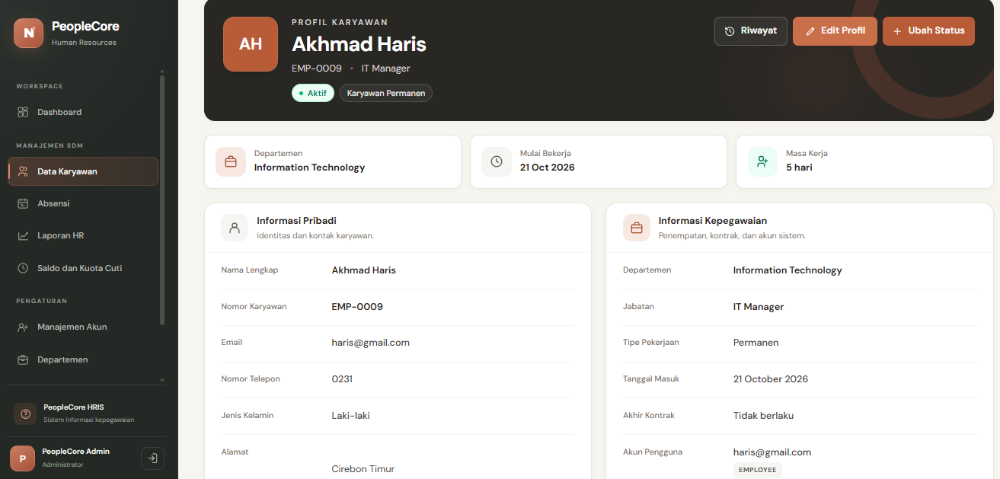
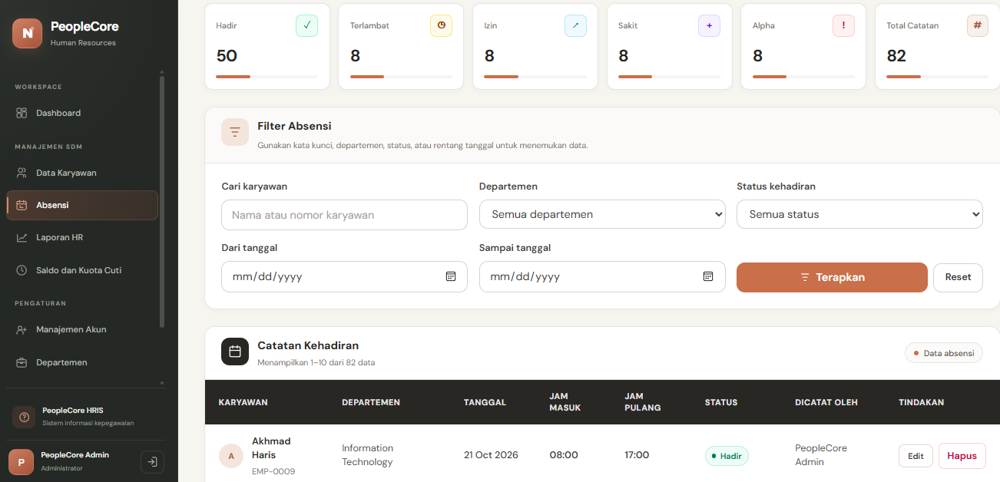
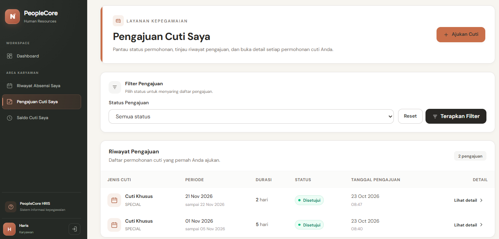

# PeopleCore — Human Resource Information System (HRIS)

PeopleCore adalah aplikasi berbasis web untuk membantu pengelolaan data dan administrasi sumber daya manusia dalam suatu perusahaan. Sistem ini dikembangkan sebagai proyek portofolio untuk menerapkan kemampuan pengembangan sistem, pengelolaan basis data, validasi data, serta penyajian informasi dan laporan.

PeopleCore menyediakan fitur pengelolaan data karyawan, struktur organisasi, kehadiran, pengajuan dan persetujuan cuti, kuota cuti, serta laporan HR dalam satu sistem terintegrasi.

## Preview Aplikasi

### 1. Dashboard

Dashboard menyajikan ringkasan informasi kepegawaian untuk membantu pengguna memantau kondisi data dan aktivitas HR.


### 2. Manajemen Data Karyawan

Halaman ini digunakan untuk mengelola data karyawan secara terstruktur, termasuk proses penambahan, peninjauan, perubahan, dan pengelolaan informasi karyawan.


### 3. Detail dan Riwayat Kepegawaian

Halaman detail karyawan menyajikan informasi kepegawaian secara lebih lengkap, termasuk riwayat kepegawaian yang tercatat dalam sistem.



### 4. Manajemen Kehadiran

Fitur kehadiran membantu pencatatan dan pemantauan status kehadiran karyawan, termasuk informasi tanggal serta waktu masuk dan keluar sesuai data yang tersedia.



### 5. Pengajuan Cuti

Karyawan dapat mengajukan cuti melalui sistem, sehingga permohonan tercatat dan dapat ditindaklanjuti sesuai alur pengelolaan cuti.



### 6. Persetujuan Cuti

Fitur ini mendukung proses pemeriksaan dan pengelolaan permohonan cuti oleh pihak yang memiliki hak akses sesuai perannya.


## Fitur Utama

### Pengelolaan Data Kepegawaian

- Manajemen data karyawan.
- Pengelolaan departemen dan jabatan.
- Pencatatan riwayat kepegawaian.
- Manajemen akun pengguna dan hak akses.

### Kehadiran dan Cuti

- Pencatatan dan pemantauan kehadiran karyawan.
- Pengajuan dan persetujuan cuti.
- Pengelolaan kuota atau saldo cuti.
- Penyimpanan data administrasi kehadiran dan cuti.

### Laporan dan Pengelolaan Data

- Penyajian laporan HR.
- Rekapitulasi data sesuai fitur laporan yang tersedia.
- Ekspor laporan ke format CSV.
- Validasi input untuk menjaga konsistensi data.

### Hak Akses Pengguna

Sistem menyediakan pembagian hak akses berdasarkan peran pengguna, yaitu:

- **Admin** — mengelola akun dan data yang menjadi kewenangannya.
- **HR** — menjalankan aktivitas administrasi kepegawaian sesuai hak aksesnya.
- **Karyawan** — mengakses fitur kepegawaian yang tersedia bagi karyawan.

## Teknologi yang Digunakan

- **Bahasa pemrograman:** PHP
- **Framework:** Laravel
- **Database:** MySQL
- **Frontend:** Blade, HTML, Tailwind CSS, dan JavaScript sesuai implementasi
- **Build tool:** Vite
- **Development tools:** Visual Studio Code, Laragon
- **Version control:** Git dan GitHub

## Struktur Proyek

```text
PeopleCore/
├── app/
│   ├── Http/
│   │   ├── Controllers/
│   │   └── Requests/
│   └── Models/
├── database/
│   ├── migrations/
│   └── seeders/
├── docs/
│   └── screenshots/
│       ├── dashboard.png
│       ├── data-karyawan.png
│       ├── detail-karyawan.png
│       ├── kehadiran.png
│       ├── kuota-cuti.png
│       ├── persetujuan-cuti.png
│       └── pengajuan-cuti.png
├── resources/
│   └── views/
├── routes/
│   └── web.php
├── tests/
├── .env.example
├── artisan
├── composer.json
├── package.json
└── README.md
```

## Instalasi dan Menjalankan Aplikasi

### Prasyarat

Pastikan perangkat sudah memiliki:

- PHP yang sesuai dengan kebutuhan versi Laravel proyek.
- Composer.
- Node.js dan npm.
- MySQL.
- Git.

### 1. Clone repository

```bash
git clone https://github.com/USERNAME/PeopleCore.git
cd PeopleCore
```

Ganti `USERNAME` dengan username GitHub pemilik repository.

### 2. Instal dependensi PHP

```bash
composer install
```

### 3. Konfigurasi environment

Salin file `.env.example` menjadi `.env`.

Pada Windows Command Prompt:

```bat
copy .env.example .env
```

Buat application key:

```bash
php artisan key:generate
```

### 4. Konfigurasi database

Buat database MySQL dengan nama `peoplecore`, kemudian sesuaikan konfigurasi database pada file `.env`.

Contoh konfigurasi lokal:

```dotenv
APP_NAME=PeopleCore
APP_ENV=local
APP_DEBUG=true
APP_URL=http://127.0.0.1:8000

DB_CONNECTION=mysql
DB_HOST=127.0.0.1
DB_PORT=3306
DB_DATABASE=peoplecore
DB_USERNAME=root
DB_PASSWORD=
```

Sesuaikan username dan password database dengan konfigurasi perangkat masing-masing. Konfigurasi di atas merupakan contoh lingkungan pengembangan lokal, bukan konfigurasi produksi.

### 5. Instal dependensi frontend

```bash
npm install
```

### 6. Jalankan migrasi database

```bash
php artisan migrate
```

Jika ingin menggunakan data demonstrasi, jalankan seeder yang tersedia dan telah disiapkan untuk lingkungan pengembangan:

```bash
php artisan db:seed
```

Pastikan konfigurasi seeder sesuai dengan kebutuhan dan data awal proyek sebelum menjalankannya.

### 7. Jalankan aplikasi

Buka terminal pertama:

```bash
php artisan serve
```

Buka terminal kedua:

```bash
npm run dev
```

Kemudian akses aplikasi melalui:

http://127.0.0.1:8000

## Pengujian

Pengujian fungsional dilakukan terhadap fitur-fitur utama yang dikembangkan, antara lain:

- Autentikasi dan pembatasan hak akses.
- Pengelolaan data karyawan dan data master.
- Pencatatan kehadiran.
- Pengajuan dan persetujuan cuti.
- Pengelolaan kuota cuti.
- Penyajian laporan dan ekspor CSV.
- Validasi input dan konsistensi relasi data.

Pengujian dilakukan untuk memastikan alur utama aplikasi berjalan sesuai fungsinya.

## Keamanan dan Pengelolaan Data

- Menggunakan autentikasi dan pembagian hak akses berdasarkan peran pengguna.
- Menerapkan validasi input pada proses pengelolaan data.
- Menggunakan file `.env` untuk konfigurasi lokal dan informasi sensitif.
- Tidak menyertakan file `.env` yang berisi kredensial ke repository publik.
- Menggunakan data fiktif untuk keperluan demonstrasi dan screenshot portofolio.

## Status Proyek

PeopleCore dikembangkan sebagai proyek portofolio yang berfokus pada pengembangan aplikasi web untuk administrasi kepegawaian, pengelolaan data terstruktur, serta penyajian laporan.

Fitur-fitur utama telah diimplementasikan dan diuji secara fungsional dalam lingkungan pengembangan.

## Lisensi

Proyek ini dibuat untuk tujuan pembelajaran dan portofolio. Ketentuan penggunaan dan distribusi mengikuti lisensi yang ditetapkan pada repository.
